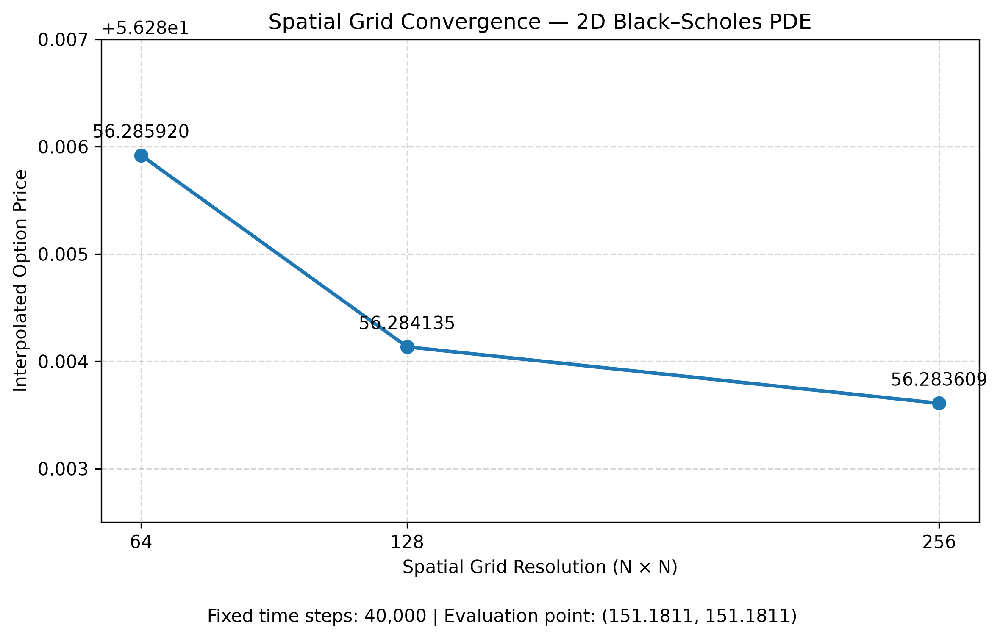

# GPU-Accelerated 2D Black–Scholes PDE Solver

A JAX-based GPU-accelerated finite-difference solver for a two-asset arithmetic-average basket call option. This README records the measured numerical validation results.

## Option Model

The terminal payoff is

$$
V(S_1,S_2,0)=\max\left(\frac{S_1+S_2}{2}-K,0\right)
$$

The time-to-maturity PDE is

$$
\begin{aligned}
\frac{\partial V}{\partial \tau} ={}&
\frac{1}{2}\sigma_1^2 S_1^2
\frac{\partial^2 V}{\partial S_1^2}
+
\frac{1}{2}\sigma_2^2 S_2^2
\frac{\partial^2 V}{\partial S_2^2}
\\
&+
\rho\sigma_1\sigma_2 S_1S_2
\frac{\partial^2 V}{\partial S_1\partial S_2}
\\
&+
rS_1\frac{\partial V}{\partial S_1}
+
rS_2\frac{\partial V}{\partial S_2}
-rV
\end{aligned}
$$

| Parameter | Value |
|---|---:|
| Strike, K | 100 |
| Risk-free rate, r | 0.05 |
| Volatility, σ₁ | 0.25 |
| Volatility, σ₂ | 0.30 |
| Correlation, ρ | 0.40 |
| Maturity, T | 1.0 year |
| Asset-price domain | [0, 300] for each asset |
| Price evaluation point | (151.1811, 151.1811) |
| Numerical precision | float64 |
| Time integration | Explicit Euler |

## Metric 1 — Numerical Precision and Solution Sanity

**Configuration:** 256 × 256 grid, 160,000 time steps.

| Metric | Recorded result |
|---|---:|
| JAX x64 enabled | `True` |
| Grid dtype | `float64` |
| Solution dtype | `float64` |
| All solution values finite | `True` |
| Minimum option value | 0.000000 |
| Maximum option value | 204.877060 |
| Negative option values | 0 |
| Lower x-boundary error | 0.0007828343118347902 |
| Lower y-boundary error | 0.0005726848273894802 |
| Runtime | 22.4280 s |

**Finding:** The run used float64 precision and produced finite, non-negative values. These are sanity checks and do not independently prove accuracy.

## Metric 2 — Time-Step Convergence

The spatial grid is fixed while the number of time steps increases. Prices are interpolated at (151.1811, 151.1811).

### 128 × 128 grid

| Grid | Time steps | Runtime (s) | PDE price |
|---|---:|---:|---:|
| 128 × 128 | 40,000 | 4.1420 | 56.284135 |
| 128 × 128 | 80,000 | 7.2754 | 56.284137 |
| 128 × 128 | 160,000 | 11.4769 | 56.284138 |

| Comparison | Absolute price difference |
|---|---:|
| 40,000 → 80,000 steps | 0.000002 |
| 80,000 → 160,000 steps | 0.000001 |
| 40,000 → 160,000 steps | 0.000003 |

### 256 × 256 grid

| Grid | Time steps | Runtime (s) | PDE price |
|---|---:|---:|---:|
| 256 × 256 | 40,000 | 6.9328 | 56.283609 |
| 256 × 256 | 160,000 | 22.4280 | 56.283612 |
| 256 × 256 | 400,000 | 53.6381 | 56.283612 |

| Comparison | Absolute price difference |
|---|---:|
| 40,000 → 160,000 steps | 0.000003 |
| 160,000 → 400,000 steps | 0.000000 at six decimal places |
| 40,000 → 400,000 steps | 0.000003 |

**Finding:** The interpolated price changes by approximately 0.000003 across the tested time-step counts at both grid resolutions, indicating strong time-step stability for these configurations. The 40,000- and 400,000-step timings are from separate runs.

## Metric 3 — Spatial-Grid Convergence

The time-step count is fixed at 40,000 while the spatial grid is refined.

| Grid | Time steps | Runtime (s) | PDE price | Absolute change from previous grid |
|---|---:|---:|---:|---:|
| 64 × 64 | 40,000 | 4.0997 | 56.285920 | — |
| 128 × 128 | 40,000 | 4.4772 | 56.284135 | 0.001785 |
| 256 × 256 | 40,000 | 6.9328 | 56.283609 | 0.000526 |

| Grid | Spatial spacing, ΔS₁ = ΔS₂ |
|---|---:|
| 64 × 64 | 4.76190476 |
| 128 × 128 | 2.36220472 |
| 256 × 256 | 1.17647059 |

| Comparison | Absolute price difference |
|---|---:|
| 64 × 64 → 128 × 128 | 0.001785 |
| 128 × 128 → 256 × 256 | 0.000526 |
| 64 × 64 → 256 × 256 | 0.002311 |
### Spatial Convergence Plot

The following figure shows the interpolated option price across spatial
grid resolutions with the time-step count fixed at 40,000.

**Finding:** The price change between successive grids decreases from 0.001785 to 0.000526 as the grid is refined. This suggests spatial stability, but these results alone do not establish a formal convergence order.

## Metric 4 — Boundary and Domain Sensitivity

This experiment evaluates lower-boundary errors at different spatial
resolutions and tests the sensitivity of the computed option price
to expansion of the computational domain.

### Lower-Boundary Error

| Grid | Upper Domain | Lower X-Boundary Error | Lower Y-Boundary Error |
|---|---:|---:|---:|
| 64 × 64 | 300 | 0.0138739547 | 0.0104261111 |
| 128 × 128 | 300 | 0.0032390780 | 0.0023906397 |
| 256 × 256 | 300 | 0.0007828343 | 0.0005726848 |
| 341 × 341 | 400 | 0.0000750949 | 0.0000236950 |

The measured lower-boundary errors decrease substantially with increasing
spatial resolution. The expanded-domain run also reports smaller
lower-boundary errors than the 256 × 256 baseline.

### Upper-Domain Sensitivity

The upper asset-price boundaries were increased from 300 to 400 for
both assets. The grid dimensions were increased to preserve approximately
the same spatial resolution, while the number of time steps and all
market parameters remained unchanged.

| Experiment | Upper Domain | Grid | Time Steps | Grid Spacing | PDE Price |
|---|---:|---:|---:|---:|---:|
| Baseline | 300 | 256 × 256 | 160,000 | 1.17647 | 56.283612 |
| Expanded Domain | 400 | 341 × 341 | 160,000 | 1.17647 | 56.283612 |

The absolute price difference is

$$
\Delta V =
|56.283612 - 56.283612|
= 0.000000.
$$

The relative price change is

$$
\frac{|56.283612 - 56.283612|}{56.283612}
\times 100
= 0.0000\%.
$$

The interpolated option price remained unchanged to the reported six
decimal places after increasing the upper domain from 300 to 400.
This indicates that the computed price at the evaluation point
$(151.1811,151.1811)$ is insensitive to this domain expansion at the
reported precision, under the tested numerical settings.

## Metric 5 — Independent Monte Carlo Validation

The PDE solver is validated against an independent Monte Carlo simulation
of correlated geometric Brownian motion. The simulation directly estimates
the discounted expected basket-call payoff without using the PDE grid.

### Simulation Configuration

| Parameter | Value |
|---|---:|
| Initial asset price, S1 | 151.1811 |
| Initial asset price, S2 | 151.1811 |
| Strike price, K | 100 |
| Risk-free rate, r | 0.05 |
| Volatility, sigma1 | 0.25 |
| Volatility, sigma2 | 0.30 |
| Asset correlation, rho | 0.40 |
| Maturity, T | 1 year |
| Monte Carlo paths | 2,000,000 |
| Batch size | 100,000 |
| Random seed | 42 |

### Validation Results

| Metric | Result |
|---|---:|
| PDE price | 56.283612 |
| Monte Carlo estimate | 56.319219 |
| Absolute difference | 0.035607 |
| Relative difference | 0.0632% |
| Monte Carlo standard error | 0.024771 |
| 95% confidence interval | [56.270669, 56.367770] |

The relative difference is calculated as
Relative Difference = $\frac{|V_{\mathrm{PDE}} - V_{\mathrm{MC}}|}{|V_{\mathrm{MC}}|} \times 100\%$

The PDE estimate lies within the Monte Carlo 95% confidence interval.
The absolute difference between the two estimates is approximately
1.44 Monte Carlo standard errors.

These results provide an independent numerical cross-check of the PDE
solver. They indicate agreement between the two methods within the
uncertainty of the Monte Carlo estimate, but do not independently establish
the full numerical accuracy of the PDE solution.

## Detailed 256 × 256, 160,000-Step Run

### Solver progress

| Step | τ | Minimum | Maximum | Center value | Finite |
|---:|---:|---:|---:|---:|---|
| 1 / 160,000 | 0.000006 | 0.000000 | 200.000031 | 50.588267 | True |
| 40,000 / 160,000 | 0.250000 | 0.000000 | 201.242220 | 51.830876 | True |
| 80,000 / 160,000 | 0.500000 | 0.000000 | 202.469009 | 53.080224 | True |
| 120,000 / 160,000 | 0.750000 | 0.000000 | 203.680559 | 54.372280 | True |
| 160,000 / 160,000 | 1.000000 | 0.000000 | 204.877060 | 55.700774 | True |

### Interpolation diagnostics

| Quantity | Recorded value |
|---|---:|
| Grid indices | i = 128, j = 128 |
| S₁[i], S₁[i+1] | 150.588235, 151.764706 |
| S₂[j], S₂[j+1] | 150.588235, 151.764706 |
| V[i,j] | 55.700774 |
| V[i+1,j] | 56.278357 |
| V[i,j+1] | 56.279560 |
| V[i+1,j+1] | 56.857549 |
| Interpolated price at (151.1811, 151.1811) | **56.283612** |

### Local grid diagnostics

| Quantity | Recorded value |
|---|---:|
| ΔS₁ | 1.1764705882352942 |
| ΔS₂ | 1.1764705882352942 |
| Target offset in S₁ cell | 0.5039349999999843 |
| Target offset in S₂ cell | 0.5039349999999843 |
| dV/dS₁ along lower edge | 0.4909454663740025 |
| dV/dS₂ along left edge | 0.49196769230034715 |
| dV/dS₁ along upper edge | 0.4912906383815677 |
| dV/dS₂ along right edge | 0.49231286430791243 |

## Monte Carlo Reference Comparison

| Metric | Recorded result |
|---|---:|
| Monte Carlo reference estimate | 56.319219 |
| PDE price | 56.283612 |
| Absolute difference | 0.035607 |
| Relative difference | 0.0632% |
| Monte Carlo standard error | 0.024771 |
| Monte Carlo 95% confidence interval | [56.270669, 56.367770] |

The PDE estimate lies inside the reported Monte Carlo 95% confidence interval. This is a useful cross-check, but it does not by itself prove the PDE result is exact; Monte Carlo sampling uncertainty, spatial discretization, and boundary approximations should be considered.

## Consolidated Results

| Grid | Time steps | Runtime (s) | PDE price |
|---|---:|---:|---:|
| 64 × 64 | 40,000 | 4.0997 | 56.285920 |
| 128 × 128 | 40,000 | 4.1420–4.4772 | 56.284135 |
| 128 × 128 | 80,000 | 7.2754 | 56.284137 |
| 128 × 128 | 160,000 | 11.4769 | 56.284138 |
| 256 × 256 | 40,000 | 6.9328 | 56.283609 |
| 256 × 256 | 160,000 | 22.4280 | 56.283612 |
| 256 × 256 | 400,000 | 53.6381 | 56.283612 |

The 128 × 128, 40,000-step runtime varied between two recorded executions (4.1420 s and 4.4772 s). A separate 256 × 256, 400,000-step execution was also recorded at approximately 53.8551 s.

## Validation Summary

| Metric | Main result | Assessment |
|---|---|---|
| Numerical precision and sanity | float64; all values finite; zero negative values | Basic checks passed |
| Time-step convergence | Price variation ≈ 0.000003 across tested step counts | Strong time-step stability in tested configurations |
| Spatial-grid convergence | Price change 0.000526 from 128 × 128 to 256 × 256 at 40,000 steps | Evidence of spatial stability; formal order not established |
| Monte Carlo comparison | PDE 56.283612; MC 56.319219; 95% CI [56.270669, 56.367770] | PDE estimate lies inside reported interval |
| Boundary/domain sensitivity | Lower-boundary errors measured; upper-domain variation not tested in these runs | Further testing required |

## Limitations and Next Steps

- Test sensitivity to the upper asset-price domain by repeating the solve with a larger maximum asset price.
- Further assess the approximate lower-boundary condition and upper-boundary extrapolation.
- Keep contract parameters and the evaluation point identical in PDE and Monte Carlo comparisons.
- Use additional grid resolutions and a consistent time-step strategy to estimate formal convergence behavior.
- Record the GPU warm-up/compilation policy and repeat timings under comparable conditions.

## Current Reference Result

For the recorded **256 × 256 grid with 160,000 time steps**:

| Metric | Value |
|---|---:|
| Interpolated PDE price | **56.283612** |
| Runtime | 22.4280 s |
| Precision | float64 |
| All values finite | True |
| Negative option values | 0 |
| Monte Carlo reference | 56.319219 |
| Absolute PDE–Monte Carlo difference | 0.035607 |
| Relative difference | 0.0632% |
